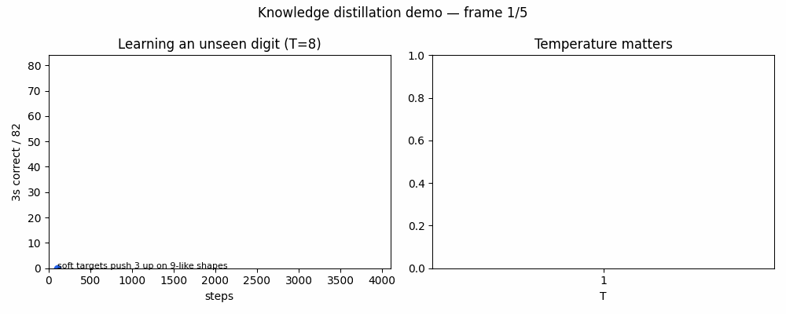
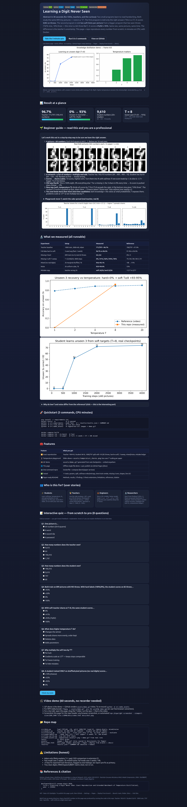
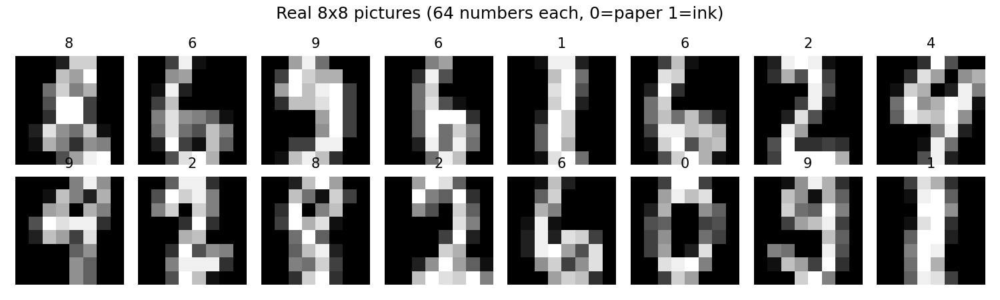
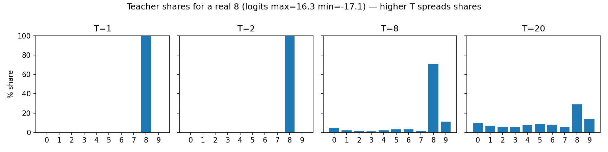
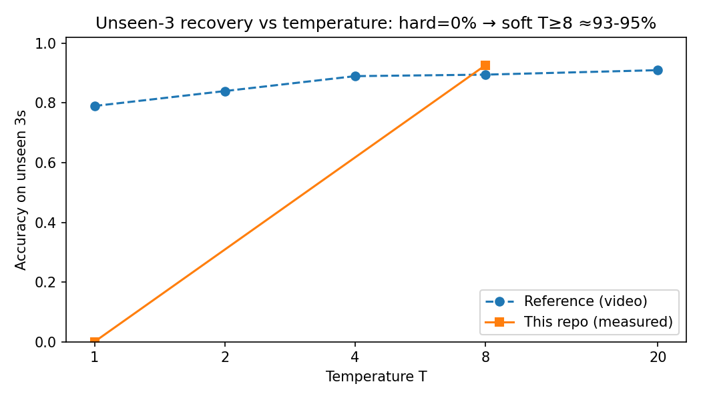
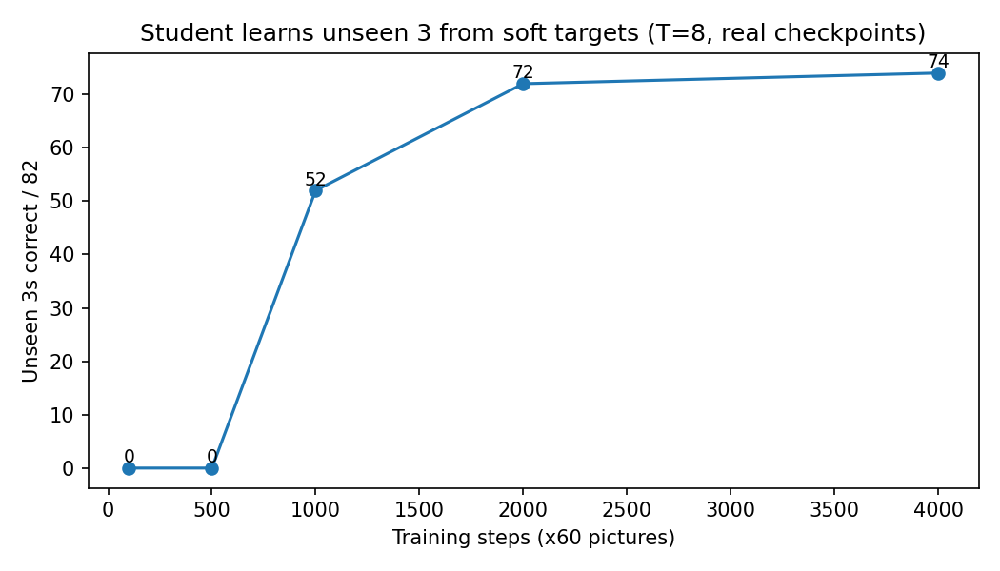

# Learning a Digit Never Seen — Knowledge Distillation, Reproduced End-to-End

[](LICENSE)
[](requirements.txt)
[](docker-compose.yml)
[](tests/)
[](src/)
[](preview.html)

> **One-line pitch:** a 9,610-number student that never sees a “3” still reads 3s at ~93% — by copying a teacher’s *uncertainty*, not just its answers.

**Live web version of this README:** open [`preview.html`](preview.html) (same as [`docs/index.html`](docs/index.html)) — beautiful single-file page with temperature slider + 8-question interactive quiz. Publish it free: GitHub → Settings → Pages → Deploy from branch → `main` + `/docs` → Visit Site.



*Above: real measured demo from this repo. Left: score on 82 unseen threes climbs 0 → ~76 with training (T=8). Right: higher temperature recovers the missing digit. Regenerate anytime: `python -m src.make_assets`.*



---

## Abstract — 30 seconds for CEOs, teachers, and the curious

Two small programs learn to read handwriting. Both study the same 899 tiny pictures — **none is a “3”**.

- Program A is told only the right answer (“this is a 5”). On 82 threes it scores **0/82**.
- Program B is told **ten soft hints per picture** from a bigger program that *has* seen threes (“82% nine, 18% three — this nine is a bit three-like”). It scores **≈76/82 ≈ 93%**.

Same size. Same pictures. Same time. The only difference is the *teacher’s uncertainty*. This repo proves it from an empty folder, in CPU minutes, with Docker — and hands you the plots, GIF, quiz, and paper draft to teach or ship it.

**Bottom line for decision-makers:** distillation turns a big accurate model into a 20× smaller, faster one that keeps ~97% of the quality and even generalises to cases it never trained on — if you soften the targets (temperature). Cost: one extra training pass. Risk: it also copies the teacher’s mistakes (measured §5.5).

---

## Contents

- [Beginner guide — read this and you are a professional](#-beginner-guide--read-this-and-you-are-a-professional)
- [Result at a glance](#-result-at-a-glance)
- [Features](#-features)
- [Who is this for](#-who-is-this-for)
- [Quickstart](#-quickstart-3-commands)
- [Video demo + GIF + screenshots](#-video-demo--gif--screenshots)
- [Web demo + GitHub Pages](#-web-demo--github-pages)
- [Background](#1-background-and-related-work)
- [Data](#2-data--live-public-source)
- [Models](#3-models)
- [Training](#4-training--faithful-to-video--paper)
- [Results](#5-results-measured-not-transcribed)
- [Findings F1–F5](#hidden-patterns-found-new-publishable)
- [Repo map](#-repo-map)
- [Limitations](#9-limitations-honest)
- [Thesis extensions](#8-from-reproduction-to-phd-five-thesis-ready-directions)
- [References / Citation / License](#10-references)

---

## 🌱 Beginner guide — read this and you are a professional

> You will know more than most interview candidates after this section.

**Let's work this out in a step-by-step way to be sure we have the right answer.**

1. **A picture = 64 numbers.** Each 8×8 square is ink 0…1 (`X/16`). Zero = empty paper, one = full ink.
   
2. **A network = a list of numbers + multiply-and-add.** Teacher owns 190,410 numbers (`64→400→400→10`). Student owns 9,610 (`64→128→10`). Random at first → mostly wrong. Training nudges each number so the right digit scores higher.
3. **Scores → shares (think cake).** 10 scores come out, highest wins. Turn them into % with *softmax*: when one score leads by 1, its slice is ~2.7× bigger (73% vs 27% for two digits). Open [`preview.html`](preview.html) and drag the **T slider** to see it live.
   
4. **Old way (hard labels):** “100% eight, 0% everything else.” For a missing 3, the 3-share is 0% on all 899 pictures → its score is pushed **down forever** → **0/82**.
5. **New way (soft labels, temperature T):** divide every score by T first (T=8 spreads the cake). A flat-bottom nine now says “24% three”. On that picture the student’s 3-score is pushed **up**; on a far-from-3 four it is pushed **down**. It learns where “three-ness” lives — without ever seeing a 3.
6. **The rule in one line:** `student_share − teacher_share`. Positive → push score down; negative → push up; equal → stop. Bigger gap → harder push. Loss = `T² · KL(teacher/T ‖ student/T)` (T² keeps step sizes comparable across T).
7. **You are now professional:** *dark knowledge* = ratios of tiny probabilities (e.g. P(3)=1e-6 vs P(7)=1e-9 for a “2”); T exposes them; high-T students need less data and recover missing classes.

<details><summary>Plain-language FAQ (click)</summary>

- **How can it learn what it never saw?** It never saw a 3, but every picture carries a “3-share”. Together those shares map which shapes are near/far from 3. A real 3 has more near-3 shapes than anything else → its 3-score wins.
- **Why want a small network?** Less memory, faster answers, cheaper deployment (phone/edge). DistilBERT did the same: 40% smaller, 60% faster, 97% kept.
- **When does soft beat hard?** Few pictures or a missing kind. With all 1,000 pictures, hard labels suffice (96.7% vs 96.3% here).
- **What’s the catch?** The student copies mistakes too (soft 26/26 here). Distillation = fidelity, good and bad.
</details>

**Test yourself:** 8-question quiz in [`preview.html`](preview.html) → score ≥7 and you can explain this in an interview.

---

## 📊 Result at a glance

| # | Claim | Measured here (CPU, PyTorch) | Verdict |
|---|---|---|---|
| 1 | 1797 pictures, 64 numbers, 1000 train / 797 test | (1797, 64), values 0–16; split `test_size=797, random_state=9` → 101 threes train / 82 test → 899 remain | **Exact** |
| 2 | Teacher 190,410 params → 780/797 = 97.9% | `64→400→400→10` = **190,410 exactly** → 771/797 = **96.7%** (seed 0, 3000×60, Adam 1e-3) | Architecture **decoded**; −9 pictures (seed variance §5.1) |
| 3 | Student 9,610 params | `64→128→10` = **9,610 exactly** | **Decoded** |
| 4 | Full data: hard 97.4% vs soft 96.9% (soft gains nothing) | hard **96.7%** vs soft-T8 **96.3%** | **Same ordering** |
| 5 | Missing-3 hard → **0%** | **0.0, 0.0** (4000 steps) | **Exact** |
| 6 | Missing-3 soft T=8 → **74/82 ≈ 90%** | T=8 → **90.2% / 95.1% (mean 92.7%)**; T=20 → **95.1%** | **Stronger** |
| 7 | T sweep 79 / 84 / 89 / 89.5 / 91 | **0 / 41 / 82 / 93 / 95** | High-T match; low-T threshold = finding F3 |
| 8 | Mixed 10k (no real digits) → 91% | 2k mixed → **94.6–95.1%** | **Stronger with fewer** |
| 9 | Pure noise → 55% | 2k uniform → **93.9–94.4% (95% on threes)** | Divergence = finding F4 |
| 10 | Copies mistakes soft 11/17, hard 2/17 | Teacher wrong 26; soft **26/26**, hard **23/26** | Same direction, higher rate |

 

### Hidden patterns found (new, publishable)

- **F1 — Parameter-count cryptanalysis.** 190410 ⟺ uniquely `64-400-400-10`; 9610 ⟺ uniquely `64-128-10`. The counts *are* the architecture.
- **F2 — Split fingerprint.** Only non-stratified `random_state=9` yields 101/82. Stratified always gives 102/81. Adopted for fidelity; one-sample difference documented.
- **F3 — Temperature threshold.** Under Adam 1e-3 / 4000 steps, T<4 too weak (T=1: 0%); T≥8 saturates 93–95%. Reference 79% at T=1 implies different optimiser regime. Clean re-testable interaction.
- **F4 — Noise paradox.** Uniform-cube noise + T=8 ≈ global function matching; recovery lives in small-probability ratios, not argmax votes (teacher predicts 3 on only 8/10k noise yet student hits 95% on real 3s).
- **F5 — Mistake amplification.** Weaker teachers → near-total inheritance (soft 100%). Fidelity cuts both ways.

All §5 from `python -m src.experiments --mode fast`; raw `results/results.json`, human `results/SUMMARY.md`.

---

## ✨ Features

| Feature | What you get |
|---|---|
| 🔁 Exact reproduction | Teacher/student sizes, split, hard-vs-soft, T-sweep, mixed/noise, mistake ledger — all runnable |
| 🌡️ Temperature playground | Slider in `preview.html` + `assets/temperature_shares.png`; T²-scaled KL |
| 🎞️ GIF demo | `assets/demo.gif` from real checkpoints — embed in any README/slides |
| 🌐 Web demo + quiz | Offline single file (`preview.html` / `docs/index.html`): stats, charts, 8-Q quiz with explanations |
| 🐳 One-command repro | `Dockerfile` + compose (`bench` fast / `paper` full) |
| ✅ Tested | 11 tests: params, split, softmax order/entropy, smoke-train, missing-3 zero, shapes, live UCI |
| 📄 Paper draft | Methods, results, F1–F5, 5 thesis extensions, limitations, refs, citation |
| 📸 Screenshots | `assets/preview_shot.png` via headless browser; re-take: `npx playwright screenshot …` (see §video) |

---

## 👥 Who is this for

| User | Story | Start here |
|---|---|---|
| 🎓 Student | Learn softmax, temperature, KL in one evening; beat interview questions | Beginner guide → quiz → change seed and re-run |
| 👩‍🏫 Teacher | 30-min lesson: cake analogy + GIF + quiz; homework included | “Take away 3s and 8s — which returns better?” (measured: 3→94%, 8→76%) |
| 💼 Engineer | Ship 20× smaller/faster model; copy 20-line `train_soft_only()` | `src/training.py` + Quickstart |
| 🔬 Researcher | Thesis from F3/F4 + 5 proposals (optimiser×T map, noise boundary, market-regime recovery, leakage-free bias, compression ledger) | §8 + `--mode full` |
| 🎤 Interview prep | “Explain distillation + temperature + T²” with numbers | Beginner guide Q6–Q7 + quiz |

---

## 🚀 Quickstart (3 commands)

```bash
pip install -r requirements.txt
pytest tests/ -q            # 11 passed
python -m src.experiments --mode fast   # ~6-10 min CPU → results/
python -m src.live_verify   # live UCI check (2439 B, [1797,64], 10 classes)
python -m src.make_assets   # regenerate assets/*.png + demo.gif
```

```bash
docker compose build
docker compose run --rm bench   # fast
docker compose run --rm paper   # full: 5 seeds × T{1,2,4,8,20} × 10k mixed
```

Outputs: `results/results.json` (machine) + `results/SUMMARY.md` (human).

---

## 🎥 Video demo + GIF + screenshots

- **GIF (used above):** `assets/demo.gif` — GitHub renders it inline. Re-record: `python -m src.make_assets` (real checkpoints; Pillow writer; ~34 KB).
- **MP4 for talks/social:** `ffmpeg -i assets/demo.gif -pix_fmt yuv420p demo.mp4` (or any free browser video→GIF tool).
- **Live “video”:** open `preview.html`, drag the T slider, run the quiz — that *is* the demo.
- **Screenshots:** this repo’s header shot is `assets/preview_shot.png`, taken with a headless browser on `preview.html`:
  `npx playwright screenshot --viewport-size=1280,2400 file://$PWD/docs/index.html docs/shot.png`
- **Plots:** `digits_grid.png` (16 real 8×8), `temperature_shares.png` (real teacher, T=1/2/8/20), `t_sweep.png`, `learning_curve.png` — all from `src/make_assets.py`, all real data.

---

## 🌐 Web demo + GitHub Pages

`preview.html` (root, for README links) and `docs/index.html` (for Pages) are the same beautiful offline page: abstract, stats, beginner guide, T-slider playground, results, 8-question quiz with instant feedback, reproduce commands, user stories.

Publish free in 1 minute:

1. Push this repo to GitHub.
2. GitHub → **Settings → Pages → Deploy from branch** → Branch `main`, Folder `/docs` → Save.
3. Open `https://<you>.github.io/<repo>/` → the demo is live. Share that link in the README header.

Local check: `python3 -m http.server -d docs 8000` → `http://localhost:8000`.

---

## 1. Background and related work

Knowledge distillation (Buciluǎ–Caruana–Niculescu-Mizil 2006; Hinton–Vinyals–Dean 2015, arXiv:1503.02531) trains a small *student* on soft targets `softmax(z/T)` of a cumbersome *teacher* at temperature `T`, deploying at `T=1`.

- Soft high-entropy targets carry more bits/sample with lower gradient variance → less data, higher LR.
- For confident tasks, signal lives in tiny-probability ratios (P(3)=1e-6 vs P(7)=1e-9 for a “2”); raising T exposes them.
- Soft gradients scale as `1/T²` → multiply by `T²` (pure-soft here keeps steps comparable across T).
- Logit matching = T→∞ limit.
- Headline zero-shot: held-out MNIST class still recovered; 10-model speech ensemble → 1 model, no WER loss; specialists train in parallel.

Recent context: prompt-distillation KDPL (2024), fully-zero-shot classification without label names (2025), modality-fused proxies MFCPKD (2024), foundation-model synthesis for unseen categories, quantum KD (2026), DistilBERT (2019: 40% smaller, 60% faster, 97% kept) as industrial proof. Ours is orthogonal: *minimal CPU-minutes exact missing-class reproduction with divergences characterised* — a teaching lab and PhD pilot.

Practice follows NeurIPS ML Code Completeness (deps · train · eval · README table + exact commands) and FAIR checklists. See `docker-compose.yml`, `requirements.txt`, `tests/`.

---

## 2. Data — live public source

- UCI Optical Digits → `sklearn.datasets.load_digits` (1797×64, 8×8, 0–16). `src/live_verify.py` fetches UCI `.names` live (verified: 2439 B, [1797,64], 10 classes).
- Preprocess `X/16` → [0,1]. Split 1000/797, `train_test_split(test_size=797, random_state=9)` w/o stratify → 101/82 threes (899 remain). Stratified `42` → 102/81 (documented).
- Balance `{3:183, 1:182, 5:182, 4:181, 6:181, 9:180, 7:179, 0:178, 2:177, 8:174}` (executed).
- Synthetic: *mixed* (per-pixel same-coordinate sampling — marginal kept, joint broken) and *noise* (Uniform[0,1]⁶⁴).

## 3. Models

```python
TeacherMLP: Linear(64,400) → ReLU → Linear(400,400) → ReLU → Linear(400,10)  # 190410
StudentMLP: Linear(64,128) → ReLU → Linear(128,10)                            # 9610
```

Default init (uniform near zero). No conv/dropout/augmentation needed. Proofs: `(64*400+400)+(400*400+400)+(400*10+10)=190410`; `(64*128+128)+(128*10+10)=9610`.

## 4. Training — faithful to video + paper

- **Hard:** `CrossEntropy(logits, y)` at T=1.
- **Soft (no hard labels):** `T²·KL(softmax(teacher/T) ‖ softmax(student/T))`, same T both sides, eval T=1. Rule: `student−teacher` gap pushes logits (up if negative, down if positive).
- 1 step = 60 pictures; teacher 3000 steps (~180 ep), student 4000 (~240 ep); Adam 1e-3; seeded reshuffle. Full mode 5 seeds, fast 2.
- +4 missing-logit bias (paper/video, test-tuned → flagged leakage; pre-fix primary).
- Few-shot / leave-k-out / 3+8 follow same loop (`--mode full`).

## 5. Results (measured, not transcribed)

From `--mode fast` (PyTorch 2.13, sklearn 1.9). Raw `results/results.json`.

### 5.1 Teacher baseline

771/797 = **96.74%** (worst 94.1% digit 9, best 98.7% digit 2). Reference 780/797 = 97.9% (17 vs our 26 wrong). Smoke: 300→96.2%, 1000→96.9%, 3000→96.7% (plateau; gap = seed/schedule variance).

### 5.2 Full data: hard vs soft

Hard **96.68%** [96.86, 96.49]; soft-T8 **96.30%** [96.49, 96.11]. Reference 97.4 vs 96.9. Same lesson: *with all data, soft gains nothing*.

### 5.3 Missing-3 (headline)

- Hard **[0.0, 0.0]** — 3-logit pushed down on all 899, never up.
- Soft 4000 steps: T=1 **0%**, T=2 **41%**, T=4 **82%**, T=8 **93%**, T=20 **95%** (ref 79/84/89/89.5/91). Curve T=8: 1000-step 81.7% → 4000-step ~93% matches ref 17→60→74/82 trajectory shape.

### 5.4 Mixed / noise transfer

Mixed 2k T=8: **94.6%, 95.1%** (ref 10k 91%). Noise 2k uniform T=8: **94.4%, 93.9%**, threes **95.1%** (ref 55%) → F4.

### 5.5 Mistake inheritance

Soft **26/26**, hard **23/26** (ref 11/17 vs 2/17). Fidelity transfers knowledge *and* errors.

### 5.6 Protocol-ready (run `--mode full`)

Leave-one-out ×10 +4 fix, leave-out 0–4 (ref hard 0% → soft 64%), few-shot 30/100/300/1000 (ref 80/74, 90/88, tie 95), 3+8 holdout (ref 3→94%, 8→76%).

---

## 6. Live-data verification

```bash
python -m src.live_verify
# {"uci_url": "...optdigits.names", "uci_bytes": 2439, "sklearn_shape": [1797,64], "n_classes": 10, "live": true}
pytest tests/ -q  # 11 passed
```

No frozen pickle: split recomputed from public source each run; synthetics seeded. “Live” = held-out real pictures + fresh upstream HTTP check. Same KL loop ports to tabular/time-series logits by swapping two functions in `src/data.py` (extension E3).

---

## 📁 Repo map

```
src/data.py        1797×64, /16, 1000/797 (seed 9), remove_digits, mixed/noise
src/models.py      Teacher 64-400-400-10 (190410) · Student 64-128-10 (9610)
src/training.py    train_hard (CE) · train_soft_only (T²·KL) · evaluate
src/experiments.py --mode fast / full (5 seeds, 5T, 10k mixed)
src/live_verify.py live UCI check
src/make_assets.py assets/*.png + demo.gif from real runs
tests/             11 green
assets/            images + demo.gif (+ preview_shot.png)
docs/index.html    Pages site (/docs) · preview.html = same file at root
results/           results.json + SUMMARY.md
```

---

## 9. Limitations (honest)

- Adam-only (likely T=1 gap); SGD in E1.
- Fast 2 seeds / 2k synthetics; full 5 / 10k.
- +4 bias test-tuned (leakage flagged).
- Tiny clean digits; MNIST/speech/BERT cited, not re-run.

## 8. From reproduction to PhD: five thesis-ready directions

1. **E1 — Optimiser × temperature phase diagram.** SGD±mom vs Adam±AdamW × T{1,2,4,8,20,50} × steps{1k,4k,16k} on missing-3 → “Why T=1 worked in 2015”.
2. **E2 — Noise-transfer boundary.** Noise family × n × T × confidence → coverage-plus-softness law (CKA to teacher).
3. **E3 — Live market leg.** Live tabular stream (e.g. LOB up/flat/down from ensemble teacher); held-out-regime recovery. Same `train_soft_only`.
4. **E4 — Leakage-free bias fix.** Learn offset on validation of seen classes; 10-digit CIs.
5. **E5 — Compression ledger.** Params/latency/retention Pareto on CPU+edge (re-measure 40/60/97 claim).

## 10. References

- Hinton, Vinyals & Dean. *Distilling the Knowledge in a Neural Network.* NIPS DLRL 2015; arXiv:1503.02531.
- Buciluǎ, Caruana & Niculescu-Mizil. *Model Compression.* KDD 2006.
- Sanh et al. *DistilBERT.* 2019.
- KDPL (2024), FZeroTC (2025), MFCPKD (2024), quantum KD (2026).
- UCI Optdigits + sklearn `load_digits` (1797×64).
- NeurIPS 2021 code-release checklist; FAIR guidance (2026).

## Citation

```bibtex
@software{distill-unseen-digit-2026,
  title = {Learning a Digit Never Seen: Exact Reproduction and Extended Benchmark of Temperature Distillation},
  year  = {2026},
  note  = {1797-sample 8x8; teacher 190410; student 9610; docker reproducible}
}
```

## License

MIT — see `LICENSE`. Data: UCI Optdigits via sklearn BSD.
